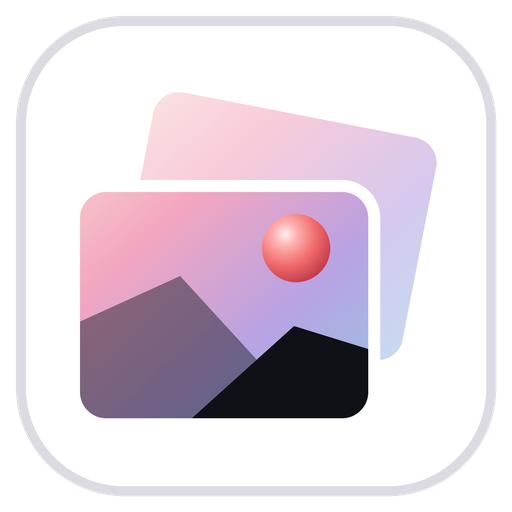
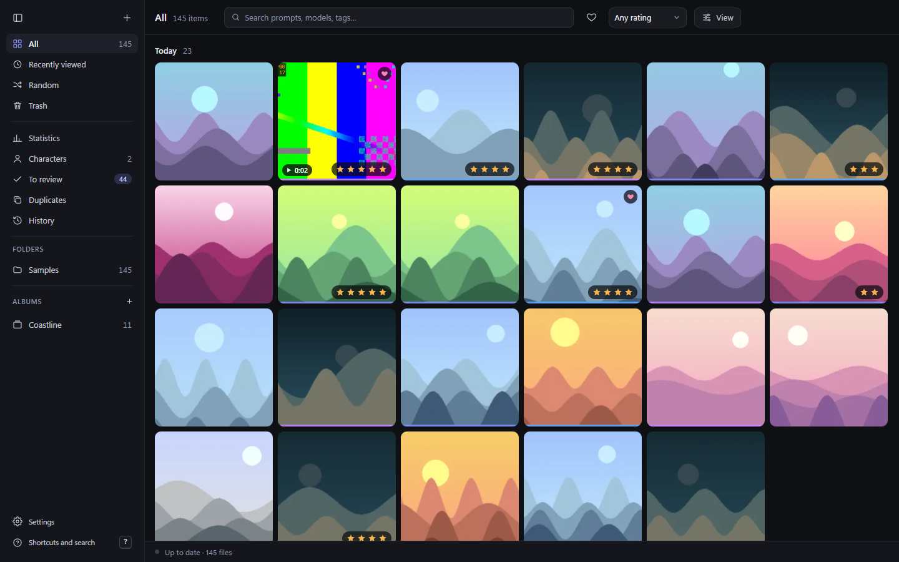
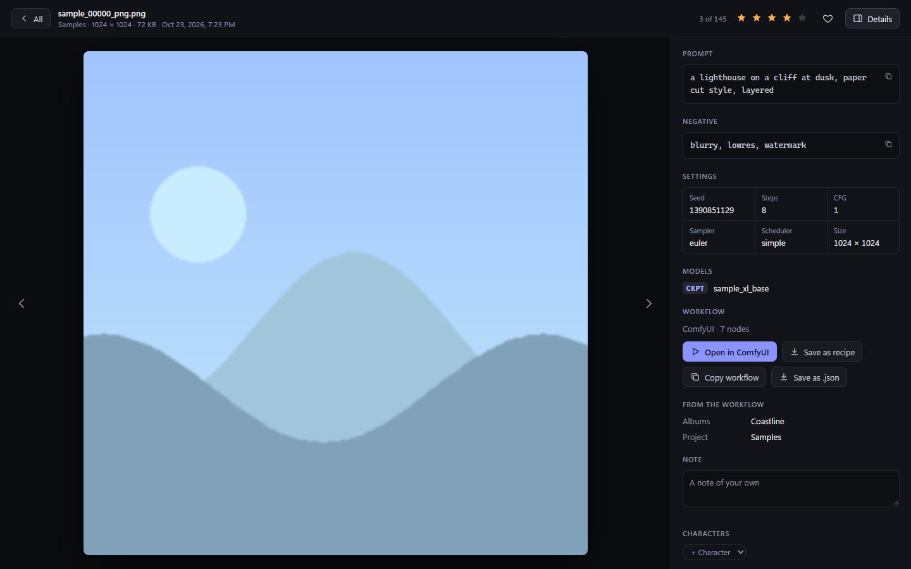
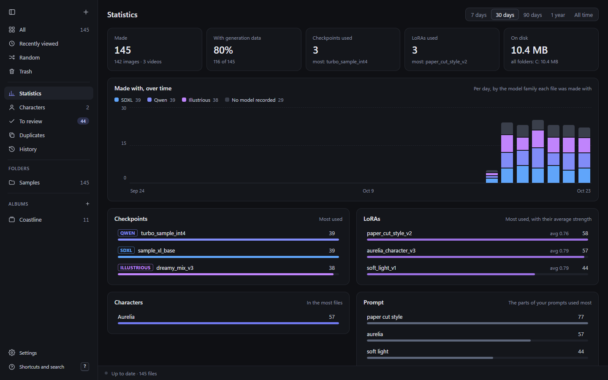
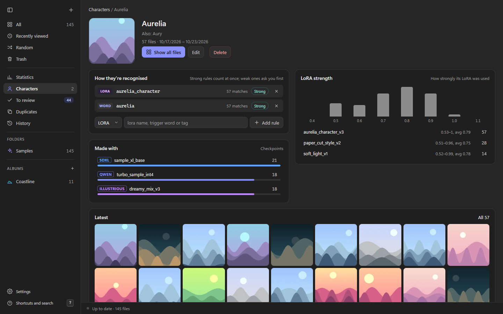
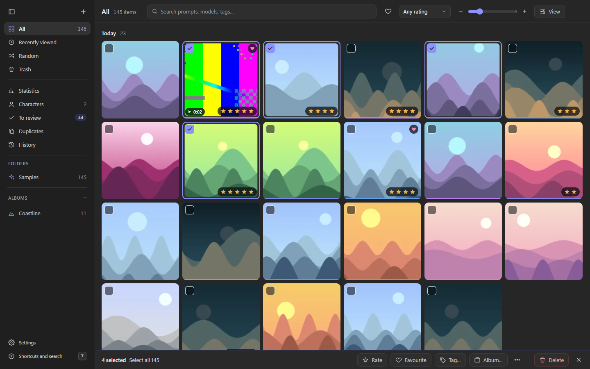

<p align="center"></p>

<h1 align="center">Model Librarian Gallery</h1>

<p align="center"><b>Browse every image and video you've generated, photographed or collected, and see what made each one.</b></p>

<p align="center">
  <a href="https://github.com/EY4O/Model-Librarian-Gallery/blob/main/LICENSE"></a>
  <a href="https://github.com/EY4O/Model-Librarian-Gallery/commits/main"></a>
  <a href="https://ko-fi.com/looneth"></a>
</p>

A Windows app for large libraries of AI generations, photos and illustrations: it indexes the folders you choose where they are (nothing is copied), reads the prompt, settings, models and workflow saved in each generation and the date each photo was taken, and lets you search, rate, tag, sort and count them, in a fast grid grouped by day. It works on its own, and works better next to [Model Librarian](https://github.com/EY4O/ComfyUI-Model-Librarian) and ComfyUI.



---

## ✨ Key Features

- ⚡ **Fast at any size** — a virtual grid that scrolls the same at 200 files or 250,000; searches and filters answer in a fraction of a second.
- 👀 **New ones as they're saved** — the folders you add are watched: a new generation is in the grid within seconds of ComfyUI saving it, and a file you move or rename keeps its ratings, tags and characters.
- 🖼️ **Grid or Waterfall** — square tiles or each picture at its own shape, a zoom bar (Ctrl + wheel), names and an info line under the tiles, and a viewer where the picture fills the stage: zoom, pan, actual size.
- ✂️ **Light editing** — flip, rotate and crop in the viewer (PNG, JPEG, WebP, HEIC, TIFF); the prompt, workflow and EXIF the file carries are kept, Save as copy keeps the original, or replace it (undoable).
- 📷 **Photos and illustrations too** — each library is for AI generations, photos, illustrations, or any mix of them (with a sidebar shortcut to each part, and `is:ai`, `is:photo`, `is:illustration`), and shows what fits: iPhone HEIC (in a photo library, Live Photos are one item that plays on hover), TIFF, BMP, AVIF, AVI and 3GP alongside PNG, JPEG, WebP and MP4; grouped by the day each photo was taken (EXIF, a video's recorded date, or the date in its name), and People in a photo library (People & characters, each marked, in a mixed one).
- 🖱️ **Drag pictures out, and in** — drag a tile (or the selection, or the picture in the viewer) to Explorer or the desktop for a copy, or straight into ComfyUI to load its workflow or use it as an input; drop tiles on an album in the sidebar to add them to it, or on a folder to move them there. Drop files or whole folders from Explorer on a folder in the sidebar (or on the pictures while a folder is open) and they're copied in, subfolders and all.
- 📁 **Folders from the sidebar** — right-click a folder for **New folder…**, and a subfolder for **Rename…**, **Move to…**, **Show in Explorer** and **Delete…** (its pictures go to the Trash); drag one folder onto another to move it. Every change is undoable.
- ▶️ **Videos play on hover** — rest on a video's tile and it plays there, silently.
- 🖌️ **Artists and sources** — in a library for illustrations, who made each picture and where it's from: read from the file, the name a site gives its downloads (Pixiv, Danbooru, DeviantArt, X and more), where Windows says it was downloaded from, or an `Artists\<name>` folder; or typed by you, for one picture or many. An **Artists** list with a page for each (their other names on other sites make them one artist), and `artist:`, `site:`, `has:source` in the search.
- 🌐 **Save from the browser** — with the [Model Librarian Chrome extension](https://chromewebstore.google.com/detail/model-librarian/dnopofnpaeindcbbgfhfjkbnjmmjjkcc) (0.6.0+), right-click any picture, or use its **Save** button on Pixiv, X, DeviantArt, the boorus and Pawchive: it's saved full size with its page, artist, title and tags, and New downloads files it with all of that. Its **+ Character** on booru posts adds characters to your list (the Gallery's and Model Librarian's); when ComfyUI isn't running, the Gallery adds them while it's open. A picture saved from a booru post offers its characters you don't have yet, to make or link to one of yours, and once filed it counts as theirs.
- 📥 **New downloads** — the pictures in your Downloads folder (and any others you add) are offered for filing (**Refresh** looks again), with who made them and where they're from: one click moves one into the library, into the folder their other pictures are in; one the library has already is marked, to delete instead.
- 🧬 **What made it** — the prompt, settings, checkpoint, LoRAs with their strengths and the ComfyUI workflow of every image and video (ComfyUI, A1111 / Forge, NovelAI, InvokeAI and more), read by Model Librarian's own readers.
- 🔍 **Search that knows generations** — words in prompts and names, plus `model:`, `lora:`, `tag:`, `character:`, `artist:`, `color:`, `rating:4`, `is:fav`, `is:photo`, `seed:`, `after:` and more, suggested as you type, down to a LoRA's strength (`lora:paper_cut@0.6-0.8`); right-click any picture for **More like this** (its checkpoint and LoRA) or **Same seed**.
- 🎨 **Colour sets** — each picture's main colours as swatches, like Eagle's: hover for the value and share, click to copy it or find every picture with that colour (`color:#140d17`, `color:red`).
- 📊 **Statistics** — what you made with over time (by model family, in Model Librarian's colours), the colours you make most, your most used checkpoints, LoRAs, prompt parts and settings, and the models you have but never use; in a library for more than one kind, for AI generations, photos or illustrations, or any of them together.
- 👤 **Characters and People** — a name plus its LoRA, trigger words or tags finds every image it's in; anything uncertain waits in **To review** for a yes or no (Z takes the last one back, and History has every run of answers). In a photo library they're People, tagged by hand.
- 🎭 **One character list with ComfyUI** — your characters are the same ones Model Librarian's **Character Select** node offers, kept in step both ways: each one's page has a **Prompt** card for its booru tag, series, appearance tags and outfits, and characters added from Danbooru with the Chrome extension arrive here with their picture and a rule to recognise them. Link a LoRA (with its trigger words) for Character Select, and pick up tags common in a character's images.
- 🗂️ **Organise with Undo** — ratings, favourites, tags, albums, moving, renaming by a pattern (`{artist}_{date}_{n}`) and deleting many files at once; every change is in **History** and Ctrl+Z undoes it. Deleting goes to the Gallery's own Trash first.
- 👆 **Swipe** — go through a folder, an album, a search or the last few days one picture at a time, big: swipe left (or A) to delete, right (or D) to keep, up (or W) to keep as a favourite, tap a star (or 1–5) to rate it, or tap an album in **Sort to album** to put it there (the ones you use most come first); Z takes the last one back. The picker at the top switches what you're going through. What you kept is remembered, so the next time starts where you left off.
- 🔎 **Smart albums** — save any search as an album that stays up to date (`artist:Mika rating:4`, `is:photo date:2024`).
- 🎞️ **Slideshow** — P in the viewer plays the view at the pace you choose.
- 🎨 **Your sidebar** — folders open to show their subfolders, and albums nest inside albums (by keyboard too, as in File Explorer's tree; moving or renaming one is undoable) ("Trips / Coast" is in Trips: drag one onto another, or **Move to…**), each showing everything inside it; **Tidy up** (beside the Albums heading) finds the albums that only repeat a folder, as an Eagle library brings in, and deletes the ones you tick in one undoable step; give any folder or album an icon (or a number, or an emoji) and a colour, from its right-click menu.
- 📱 **Phone and tablet** — pair a phone or tablet by scanning a QR code and look through the library on it, anywhere over Tailscale (only your own Tailscale account's devices, with HTTPS if you like) or on your home Wi-Fi: big tiles, swipe from one picture to the next, pinch to zoom; rate, favourite, tag, albums, Swipe and the Trash, and save a picture or video to the phone's own photos. Add it to the home screen and it opens like an app. Only the devices you pair get in.
- ♻️ **Duplicates** — exact copies, and the same picture saved twice in another format or size; **Compare** shows them side by side at full size before you choose (videos play together), and **Keep both** leaves a group alone for good.
- 🧾 **Recipes** — turn on **Recipes** in Settings and Model Librarian's recipes are in the sidebar as cards, with a page each: the prompt, settings and every model with its strength, to copy, tag, favourite, find the pictures made with them, or open in Model Librarian's Recipes tab in ComfyUI (to download what's missing) or as a new workflow. Bring them in from pictures in the library, files dropped from Explorer, CivitAI links and recipe files, and from the Chrome extension when ComfyUI isn't running.
- 🔗 **Model Librarian and ComfyUI** — **Open in ComfyUI** opens a file's workflow in a new ComfyUI tab, **Save as recipe** puts it in Model Librarian's recipes, and the **Gallery Info** node tags images as they're made.
- 🦅 **Leaving Eagle** — bring an Eagle library in as plain files, laid out by its folders, into a library of its own or this one, with its tags, ratings, notes, links and colours (Eagle's library is only read); or send any selection to Eagle.
- 🧺 **In the tray** — turn on **Keep running in the tray** and closing the window leaves the Gallery by the clock: phones, new-download notifications and the folder watcher keep working, and its menu opens New downloads, turns Phone and tablet on or off, pauses watching and quits. It can start there when you sign in, too.
- 🔄 **Updates when you want them** — turn on **Updates** in Settings and the portable Gallery asks GitHub once a day for a new version, then installs it at its next start.
- 💼 **A library you can take anywhere** — make any folder a library and its index, thumbnails and backups live inside it: copy it to an external drive and open it on any PC, whatever drive letter it gets.
- 🛡️ **Your files stay yours** — indexing only reads; nothing leaves your PC.

## 📸 Screenshots

| | |
|---|---|
|  **Viewer** — the file full size, with its prompt, settings, models, workflow, tags and characters beside it |  **Statistics** — what you made with over time, and your most used models, LoRAs and settings |
|  **Characters** — how one is recognised, its LoRA strengths, what it's made with |  **Organise** — select any number of files and rate, tag, file or move them at once |

<sub>Screenshots use generated sample data and made-up model names.</sub>

---

## 📦 Installation

### Option 1: **Download the portable folder** (Recommended)

1. From the [latest release](https://github.com/EY4O/Model-Librarian-Gallery/releases/latest), download **Model-Librarian-Gallery-&lt;version&gt;-portable.zip** (about 100 MB; it brings its own Python and ffmpeg).
2. Unzip it somewhere outside OneDrive, such as `%LOCALAPPDATA%\Programs`.
3. Start **Model Librarian Gallery.exe** in the unzipped folder. The program isn't signed yet, so Windows SmartScreen may warn you the first time: choose **More info → Run anyway**.

Then use **Settings → Add the Gallery to the Start menu**, or right-click its taskbar button and choose **Pin to taskbar**. To keep it up to date, turn on **Settings → Updates**.

### Option 2: **Build the portable folder**

Build it once from a checkout. It copies a standalone Python 3.12 and ffmpeg from your PC; only the app's packages are fetched, if uv doesn't have them yet:

```bash
git clone https://github.com/EY4O/Model-Librarian-Gallery.git
cd Model-Librarian-Gallery
uv run --python 3.12 --no-project tools/build_portable.py
```

It lands in `%LOCALAPPDATA%\Programs\Model Librarian Gallery`. Start **Model Librarian Gallery.exe** there, then use **Settings → Add the Gallery to the Start menu**. To keep it up to date, turn on **Settings → Updates**.

### Option 3: **Run from the checkout**

Needs [uv](https://docs.astral.sh/uv/getting-started/installation/), which fetches the right Python by itself:

```bash
git clone https://github.com/EY4O/Model-Librarian-Gallery.git
cd Model-Librarian-Gallery
run.bat
```

The first start sets up the app's own Python in `.venv`; later starts open straight away. `run.bat --browser` opens it in your browser instead of its own window.

<details>
<summary><b>Optional companions</b></summary>

- **ffmpeg** — for video posters and lengths. The portable folder (downloaded or built) brings its own; otherwise the one on PATH is used, or set its path in **Settings**.
- **Model Librarian** — found by itself in your models folder (`.sm_model_fetcher`). It links your files to the models you have (and shows the ones you never use), and receives **Save as recipe**.
- **ComfyUI with Model Librarian 1.23 or newer** — for **Open in ComfyUI** (1.29.0 or newer to open a recipe in its Recipes tab); set ComfyUI's address in **Settings** if it isn't `http://127.0.0.1:8188`.
</details>

## 🚀 Getting Started

1. Start the Gallery and click **Add a folder** (or **+** at the top of the sidebar). Pick a folder of generations, such as ComfyUI's `output` folder.
2. Your files appear as they're indexed, newest first, grouped by day; prompts and settings are read in the background.
3. Click a tile to open it and see what made it. **←** **→** step through, **1**–**5** rate, **F** favourites, **I** shows or hides the details, **Delete** moves it to the Trash, **Esc** goes back.
4. Search from the top: `lora:` or `model:` followed by a name narrows it down (names are suggested), `rating:4` and `is:fav` find your best.
5. Open **Statistics** to see what you make with, and **Characters** to have the Gallery find a character everywhere.

---

## 📖 How It Works

<details>
<summary><b>📁 Folders, the index and thumbnails</b></summary>

- The Gallery indexes the folders you add where they are. A rescan only looks at files that changed; a folder watcher picks up new generations within seconds.
- Each file gets a quick fingerprint (its size and first and last 64 KB), so a file you move or rename keeps its ratings, tags and characters. A drive that isn't plugged in keeps its files, shown again when it's back.
- Thumbnails are small WebP files kept by fingerprint, made in the background, newest first. Videos get a poster frame from ffmpeg.
- While the Gallery works in the background (indexing, thumbnails, reading prompts, dates and artists), the status bar shows a bar and about how long is left.
- The index is one SQLite file, backed up daily (the last 7 kept). Your files' own data can always be read again from them; your ratings, tags, albums and characters live in the index. This PC's library keeps it in `%LOCALAPPDATA%\Model Librarian Gallery`.
- Hidden and system folders, and Eagle libraries (`*.library`), are never indexed.
</details>

<details>
<summary><b>🖌️ Artists, sources and new downloads</b></summary>

- In a library for illustrations, each picture's artist and source are looked for in the background: in the file's own details (EXIF Artist, XMP creator, a PNG's Author, a source link written in it), in where Windows says it was downloaded from (the page, kept with the file), in the name a site gives its downloads (`12345678_p0.png` from Pixiv, `…_drawn_by_<artist>__<md5>` from Danbooru, `…_by_<artist>_d1a2b3c` from DeviantArt, Twitter Media Downloader's names, yande.re, Konachan, Fur Affinity), in gallery-dl's `<site>\<artist>` folders, and in an `Artists\<name>` folder of yours. AI generations are left out.
- What you type wins, then the file, then where it was downloaded from, then its name, then its folder; the details panel says where each came from and what else was found. **Set the artist** (the selection's More menu) does many at once, with Undo.
- Every artist found is in the **Artists** list, with a page: the sites their pictures came from, the folders they're kept in, their links. Give an artist another name (their handle on another site) and the artist with that name becomes the same one.
- **New downloads** can tell you when new pictures arrive (a Windows notification; Settings, New downloads), and has keys of its own: the arrows move, F files, E files elsewhere, D dismisses, X selects.
- **New downloads** lists the pictures and videos in your Downloads folder (and others set in Settings; only the folders themselves, not the ones inside), newest first. **File** moves one into the library, into the folder its artist's other pictures are in, or an `Artists\<name>` folder of their own; **Elsewhere** picks the folder and the artist. A download the library has already (the same bytes) is marked, to send to the Recycle Bin instead. **Dismiss** stops offering one. Filing is in History, and Undo puts the download back.
- Bringing in an Eagle library records each item's source link as its source too.
- Pictures saved by the Chrome extension (in `Downloads\Model Librarian Gallery`, offered with your Downloads) come with a note of their page, artist and their page, title and tags: filing one gives it its artist and source, the tags (marked as from the site: one you take off stays off), the title as its note, and the artist's page as one of their links. Notes are only read in that folder (one beside a file anywhere else could have been put there by any site). If Chrome saves somewhere other than your Downloads folder, add that folder's `Model Librarian Gallery` in **Settings → New downloads**.
- **A saved booru picture's characters** (1.19.0+, with the extension 0.9.0): its note lists the post's characters, and New downloads shows each under the picture: a ✓ and the name for one you have, otherwise **Add** (a new character, its series and look from the post) or **Link…** (one of yours: it gets the booru tag, the post's look and an outfit; its name stays yours). One of yours with the same name in either order and no tag yet is offered first, as **Add to *name***. A character's booru tag (or its name) also matches a picture's tags, not only its prompt, so the saved picture is theirs as soon as it's filed, and so are the ones saved with that tag later.
- Characters the extension saves from a booru post (**+ Character**) while ComfyUI isn't running wait in that same folder as `.mlchar.json` files. While the Gallery is open it adds each to Model Librarian's character list (`characters.json` in Model Librarian's data folder, found as for Statistics or set in Settings) and removes the file. Without Model Librarian's folder they wait.
- **Characters are shared with Model Librarian** (1.16.0+, with Model Librarian 1.25.1): every character (not people) is in both, in a library for AI generations or illustrations (one only for photos keeps out), and while the Gallery is open they're kept in step (when it starts, every 15 seconds, and right after you change one). A character's page has a **Prompt** card: its booru tag, series, appearance tags and outfits, as the **Character Select** node writes them in ComfyUI. Click a tag's × to take it out, type in the box beside them (Enter; several separated by commas) to add, and rename, delete or add outfits. When a character changed in both places, each part keeps the latest change. Deleting a character here deletes it from Model Librarian's list too, and one deleted there goes here; so does one you make a person. When the sync can't happen (Model Librarian's list unreadable, or from a newer version), the character's page says why. A character that comes from the list is recognised by its booru tag in the prompt (a strong word rule); remove it and it stays removed. Until the Gallery has a file of it, a character shows the list's picture (from Danbooru); the portrait you pick (right-click a picture on its page) becomes its picture in Character Select.
- **LoRA** (1.17.0+, with Model Librarian 1.26.0): on the Prompt card, link one of the LoRAs Model Librarian has; Character Select loads it, with its trigger words first (filled in from its metadata; take out the ones you don't want, or add your own). A linked LoRA doesn't change how the Gallery recognises the character: its rules are yours. It can also be linked in ComfyUI (on the node, or from the Library) and from the Chrome extension on CivitAI.
- **From your images:** once a few images of a character count, the Prompt card suggests the hair, eyes and clothing tags common in their prompts (with how often), leaving out the ones it has: click one to add it to Appearance, or to the outfit picked beside the outfit suggestions.
</details>

<details>
<summary><b>🦅 Leaving Eagle</b></summary>

- **Settings → Eagle → Bring in an Eagle library** reads its `.library` folder (only reads: nothing in it changes) and asks where it goes: into a new library of its own, in a folder you pick, or into the library that's open.
- Each item is copied out, checked against the original, laid out by its Eagle folder (`Characters\Aurelia\…`; an item in several goes into the first, items in none into `Unfiled`), under the name Eagle shows, keeping the date it was added to Eagle.
- Its tags, star rating and note come along; its source link goes on a line of its own at the end of the note; every Eagle folder becomes an album too; Eagle's colours become its colour set. A file the library already has (the same bytes) just gets the marks, without a second copy.
- A bar shows how far it's got and about how long is left (worked out from the pace so far, by the bytes while copying). **Keep using the Gallery** hides it: the status bar carries on, and a click there opens it again. **Stop** stops after the file in hand; what's copied so far stays, with its marks.
- It's one step in History: Undo takes the marks off and moves the copies to the Gallery's Trash. Once you're happy, delete the Eagle library yourself.
</details>

<details>
<summary><b>🎨 Colour sets</b></summary>

- Every picture gets a colour set: its main colours and how much of it each covers, worked out from its thumbnail in the background (pictures from Eagle start with Eagle's).
- The viewer shows them as swatches under the file's name; hover for the value and share, click to find every picture with that colour or its family, or to copy its value.
- `color:#140d17` finds pictures with a colour that looks like it (covering at least 5%); `color:red` (or orange, yellow, green, cyan, blue, purple, pink, brown, black, gray, white) a colour of that family covering at least 10%.
- Statistics shows the colours of what you made, over time.
</details>

<details>
<summary><b>💼 Libraries you can take anywhere</b></summary>

- **Settings → Library → New library** makes any folder a library: everything in it is indexed, and the Gallery keeps the index, thumbnails and backups in a hidden `.mlgallery` folder inside it. Your files stay ordinary files in ordinary folders.
- Copy or move the whole folder to an external drive or another PC and open it there (**Open library**): its folders follow it to the new place or drive letter, with their ratings, tags, albums, characters, notes and History.
- A new library can bring the ratings, tags, albums, characters and notes the same files have in the library you're in, matched by their bytes. It's one step in History, so Undo takes it back.
- The Gallery opens the library you used last; if its drive isn't plugged in, this PC's library opens instead and says so. The portable Gallery kept inside a library's folder opens that library.
- Settings such as ComfyUI's address, ffmpeg and Updates belong to each PC and stay on it. Folders added from outside a library keep their full path, so another PC shows them as not reachable.
</details>

<details>
<summary><b>🧬 What's read from each file</b></summary>

The readers are Model Librarian's, kept identical by a test: ComfyUI's `prompt` and `workflow` (PNG, WebP, and videos from Save Video and Video Helper Suite), A1111 / Forge `parameters` (with LoRA tags and hashes), NovelAI, InvokeAI, SwarmUI and Fooocus. The workflow is stored compressed and unpacked only when you open it; prompts are split into their parts for statistics.
</details>

<details>
<summary><b>🧾 Recipes</b></summary>

- **Recipes** is off until you turn it on (**Settings → Model Librarian and ComfyUI**). They're Model Librarian's own: each is a file in the `recipes` folder of its data folder (found as for Statistics, or set in Settings), the same ones its Recipes tab shows, so there's nothing to keep in step. Without Model Librarian's folder there are none to show.
- **Bringing them in:** drop pictures, videos or recipe files (Model Librarian's `.json`, or LoRA Manager's) on the Recipes page or use **Choose files…**; **Paste a link…** takes a CivitAI image or post (pick one of a post's images) or a link to a picture; **Save as recipe(s)** in the selection's More menu takes pictures from the library. Each is a new recipe with a 512 px picture; a file with no generation data is skipped and said so.
- **From the Chrome extension** (0.10.0+): on a CivitAI image, while ComfyUI isn't running, **Save for the Gallery** leaves the image's link in `Downloads\Model Librarian Gallery` as a `.mlrecipe.json` file. While the Gallery is open (with Recipes on) it reads the image from CivitAI, saves the recipe and removes the file; one CivitAI can't be reached for is tried again later.
- **A recipe's page:** the picture, where it came from, the prompt and negative prompt, the settings and each model with its strength. **Copy all** copies it as A1111-style text; rename it, tag it, favourite it, write notes, or delete it (it goes to `recipes\_deleted`). **Find its pictures** searches the library for its checkpoint and LoRAs. The Recipes list searches titles, prompts, models and tags, with Favourites and a tag filter.
- **To ComfyUI:** **Open in Model Librarian** opens it in Model Librarian's Recipes tab in your ComfyUI (Model Librarian 1.29.0 or newer), to download what's missing and fill the workflow; **Open as a new workflow** opens the workflow it was made with in a new tab, when it has one.
</details>

<details>
<summary><b>🏷️ The Gallery Info node</b></summary>

A node in Model Librarian's pack: put **Gallery Info (Model Librarian)** before your save node and fill in albums, tags, characters, a project, a rating or a note. Every save node writes it into the file with the workflow, and the Gallery files the image under it straight away: albums and tags are added, characters count as confirmed, and the rating applies unless you've set your own. Its folder pattern (`{project}/{character}/{date}/`) can also save each file straight into its folder.
</details>

<details>
<summary><b>👤 Characters</b></summary>

A character is a name, aliases, and rules: a **LoRA** (any version or strength) or **trigger words** are strong and count straight away; a **tag** is weak and sends matches to **To review**. Your yes and no stick: a file you rejected is never suggested again, and a weak rule you mostly reject goes quiet. Names from a workflow's Gallery Info node count as confirmed. A name is the same in either order (Danbooru's family name first, as in `vale_lumen`, or yours), so a trigger word that is the character's name matches prompts written either way. Each character has a page with its LoRA strengths, the checkpoints it's made with, and its files by month.
</details>

<details>
<summary><b>📊 Statistics and model families</b></summary>

Statistics count the files made in a range (7 days to all time): what they were made with over time, by model family (Illustrious, Qwen, Flux, ...), your top checkpoints, LoRAs with their average strength, prompt parts, samplers, schedulers, steps, CFG and sizes, and storage per folder and drive. A model's family comes from where Model Librarian's organizer filed it (including folders of your own), the CivitAI base model next to it, or its name. With Model Librarian's library found, **Never used** lists the models no file was made with. Every bar opens those files.
</details>

<details>
<summary><b>📱 Phone and tablet</b></summary>

- Turn it on in **Settings, Phone and tablet**. The first time, Windows asks whether the Gallery may use the network: allow it on private networks.
- **How they reach it**, one way at a time:
  - **Over Tailscale** (chosen by itself when [Tailscale](https://tailscale.com) is installed on the PC): the Gallery listens only on the PC's Tailscale addresses, so the Wi-Fi can't reach it, and answers only devices signed in to Tailscale with the PC's own account (never a tagged device; a PC that's itself tagged has no account to check against, so it needs to be signed in as you). With the tailnet's HTTPS certificates on (Tailscale's admin console, DNS), Settings offers HTTPS with a real certificate for the PC's tailnet name; it asks first, since certificates are listed in public logs (which shows the PC's name), and renews it by itself. It works away from home, and it's encrypted either way.
  - **Home Wi-Fi**: only on the PC's home network address, and unencrypted, so anyone on that network who can watch its traffic could see what's shown. Settings asks you to agree to that the first time, and labels it.
- **Pair a device…** shows a QR code: scan it with the phone or tablet's camera and open the link. Or open the address it shows and type the code. A code lasts 10 minutes and pairs one device; a device that types 5 wrong codes can't try it again. The device is remembered by a key in a cookie (the PC keeps only a hash of it); Settings lists each one, to rename or remove, and a device not seen for 30 days is forgotten.
- A device's key changes now and then as it opens the library: a new one is offered, and the old one stops working once the device has the new one. If an old copy of a key turns up after that, that device is unpaired at once and you're told, in Settings and by a Windows notification. (It can't stop someone watching an unencrypted Wi-Fi all along, who sees each new key too: that's what Tailscale is for. Opening the Gallery on one device from two places, a browser and its home-screen icon, can look like a copy: pair each.)
- **As an app:** Browse has **Install app** (and the first visit a one-time hint). On an iPhone or iPad it's Share, then Add to Home Screen; on Android, over Tailscale with HTTPS, it installs as a full app with its own window, and long-pressing its icon offers Swipe, Favourites and Recently viewed. The app keeps only its own files on the phone, never your pictures, and shows a clear "Can't reach the PC" screen when the PC is away. An installed app keeps its own sign-in: pair it once with a new code.
- **Save to the phone's photos** (1.18.0+, over Tailscale with HTTPS): the save button at the top of a picture, or **Save** for a selection (up to 20 at once), hands the file to the phone's share sheet: **Save Image** or **Save Video** on an iPhone or iPad, the gallery (or Photos) on Android. It's the file itself (a PNG keeps its prompt and workflow); HEIC and TIFF go as a full-size JPEG, with when and where they were taken. The phone only takes files from a page over HTTPS, so on home Wi-Fi there's no Save.
- On a phone the library is big tiles with a bar at the bottom: **Library**, **Browse** (folders, albums, artists, characters and the Trash), **Swipe** and **Search**. A tap opens a picture (swipe to the next, pinch or double-tap to zoom, pull down to close); a long press selects, to rate, favourite, tag, put in an album or a character, save, or delete. A picture's details show its tags, albums, characters, artist and note, to change there.
- Settings, folders, moving and renaming files, bringing in Eagle and filing downloads stay on the PC.
</details>

<details>
<summary><b>🛡️ Safety</b></summary>

- Indexing only reads. Files are moved or deleted only when you ask, and everything you change is in **History** with **Undo** (Ctrl+Z).
- A move shows what will happen first and only goes into your library folders. Across drives it copies, checks the copy's size and fingerprint, then removes the original.
- **Delete** moves a file to the Gallery's Trash (a hidden `.mlg-trash` folder in its own library folder), from where **Put back** restores it. Emptying the Trash sends files to the Windows Recycle Bin.
- The Gallery listens on 127.0.0.1 only, with a new token each start; other programs and web pages can't use it. It sends nothing anywhere: Open in ComfyUI talks only to the ComfyUI address you set, and Recipes only reads a CivitAI image or picture you give it a link to (public `https://` addresses only, never one on your own network).
- **Phone and tablet** is off until you turn it on. Then the Gallery also listens on one network, on a port of its own: Tailscale's addresses (answering only your own account's devices) or the home network's address. It answers only devices you've paired and only private addresses: a request from the internet isn't answered, even if a router forwards the port. A paired device can look and organise; it can't change Settings or folders, move, rename or empty anything. Its key changes as it's used, and an old copy that turns up gets the device unpaired. Only the Gallery's own address or name is answered, and the Tailscale command is only ever the one Tailscale installs.
- **Starting at sign-in** is off until you turn it on in Settings, In the background: it adds the Gallery to your own Windows user's sign-in list (the Run key), and turning it off takes it out again.
- **Updates** are off until you turn them on. Checking only reads GitHub's list of releases. An update is checked against its SHA-256 before it's unpacked beside the app, and the Gallery swaps it in at its next start, while it's closed.
</details>

---

## 🧪 Development

Tests, performance timings, the portable build and releasing are described in **[docs/DEVELOPMENT.md](docs/DEVELOPMENT.md)**. The plan is in **[docs/PLAN.md](docs/PLAN.md)**.

## 🤝 Contributing

Issues and pull requests are welcome; please run the test suite before opening a PR.

## 🙏 Credits

- [pywebview](https://pywebview.flowrl.com/) — the app's own window (Edge WebView2)
- [aiohttp](https://docs.aiohttp.org/), [Pillow](https://python-pillow.org/), [watchdog](https://github.com/gorakhargosh/watchdog), [Send2Trash](https://github.com/arsenetar/send2trash)
- [FFmpeg](https://ffmpeg.org/) — video posters and lengths
- [Model Librarian](https://github.com/EY4O/ComfyUI-Model-Librarian) — the metadata readers, model families and the Gallery Info node

## ☕ Support

If the Gallery helps you find your way around your generations, you can support its development:

[](https://ko-fi.com/looneth)

## 📄 License

[MIT](LICENSE)

## 📜 Changelog

<details>
<summary><b>Every version, newest first</b></summary>

Each version's full notes are on its [release page](https://github.com/EY4O/Model-Librarian-Gallery/releases). 1.15.0 to 1.17.1 went out together in 1.18.0, 1.2.0 with 1.3.0, and versions before 1.1.3 came before the Gallery had releases.

- **1.21.0** — Recipes: Model Librarian's recipes in the sidebar, brought in from pictures, files, CivitAI links and the Chrome extension, and opened in ComfyUI.
- **1.20.1** — Swipe: a star lights every star up to it, and the picture stays a moment with its rating before the next one.
- **1.20.0** — Make, rename, move and delete folders from the sidebar; drag pictures onto a folder to move them, and drop files from Explorer to copy them in.
- **1.19.1** — Fixes for linking characters: one with a tag of its own, two of a name in other series, Add clicked twice.
- **1.19.0** — A picture saved from Danbooru offers its characters to add or link to yours, and counts as theirs once filed.
- **1.18.1** — A character's name counts in either order (family name first, as Danbooru writes it, or last).
- **1.18.0** — Save a picture or video to your phone's photos, over Tailscale with HTTPS.
- **1.17.1** — Fixes and polish for the character sync with Model Librarian.
- **1.17.0** — Link a LoRA to a character, and get hair, eye and clothing tags suggested from your images.
- **1.16.0** — One character list shared with ComfyUI's Character Select, kept in step both ways.
- **1.15.0** — Characters added from the Chrome extension arrive even while ComfyUI is off.
- **1.14.1** — The Gallery's own icon on an iPhone's home screen.
- **1.14.0** — The phone page as an app on your home screen, with shortcuts to Swipe, Favourites and Recently viewed.
- **1.13.0** — Phones and tablets over Tailscale: your account only, with HTTPS.
- **1.12.0** — A warmer darkroom look, a menu on every picture, and To review one at a time.
- **1.11.0** — Drag pictures out to Explorer, the desktop or ComfyUI.
- **1.10.0** — Undo for album moves and To review, the sidebar by keyboard.
- **1.9.1** — Statistics for AI generations, photos or illustrations, and fixes from a QA pass.
- **1.9.0** — Keep running in the tray, and start there when you sign in.
- **1.8.1** — Tidying up albums, keeping both of a duplicate, and comparing videos.
- **1.8.0** — Your library on a phone or tablet, nested folders and albums, and a new Swipe.
- **1.7.0** — Pictures saved from the browser, with their page, artist, title and tags.
- **1.6.0** — Swipe, smart albums, renaming by a pattern, a slideshow, and duplicates side by side.
- **1.5.1** — A progress bar and time left for long jobs, and Stop for an Eagle import.
- **1.5.0** — Who made each picture and where it's from, an Artists list, and new downloads offered for filing.
- **1.4.0** — Photos and illustrations as well as AI generations, and libraries that hold all three.
- **1.3.2** — Each library listed once, and the window opens where you left it.
- **1.3.1** — Pinning the Gallery to the taskbar pins the Gallery, not Python.
- **1.3.0** — Leaving Eagle: an Eagle library brought in as plain files, and colour sets for every picture.
- **1.2.0** — Libraries you can take anywhere: a folder that carries its own index, even on an external drive.
- **1.1.4** — Installing an update from GitHub works.
- **1.1.3** — The portable Gallery starts from its own .exe and can update itself from GitHub Releases.
- **1.1.2** — Emptying the Trash also clears the originals kept for undoing edits.
- **1.1.1** — Windows' own typeface, Waterfall by default, and Save as copy as the main way to save an edit.
- **1.1.0** — Eagle-style viewing: a charcoal theme, a zoom bar, Waterfall, folder icons and colours, and a viewer with flip, rotate and crop.
- **1.0.1** — Fixes from a bug hunt, a QA pass and a design review.
- **1.0.0** — The first release: the viewer and search, Statistics, Characters, albums with undo, the portable package, and the Eagle bridge.

</details>
